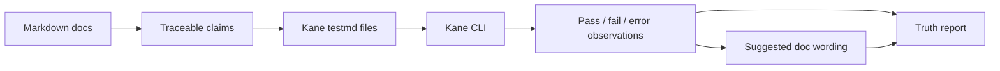

# Docsworn

Docsworn turns behavioral claims in Markdown documentation into traceable Kane CLI tests, runs those tests against a live application, and writes a Documentation Truth Report.

Documentation drifts as products change. Docsworn makes that drift visible at the exact source file and line, while keeping Kane's product failures separate from authentication, browser, network, and timeout errors.

## Quick start

Requirements: Node.js 20.19 or newer. The deterministic demo does not require a model key or Kane account.

```bash
git clone https://github.com/arinze116/Docsworn.git
cd Docsworn
npm ci
npm run ci
npm run demo
```

The demo reads [`demo/fixture-app/README.md`](demo/fixture-app/README.md), generates Kane `_test.md` files in `.kane-demo/`, and writes `doctruth-report.md` from labelled captured Kane evidence. It intentionally includes three stale claims, one verified claim, and one subjective claim.

## Run against a live application

Install and authenticate Kane CLI first:

```bash
npm install --global @testmuai/kane-cli@0.10.5
kane-cli login --oauth
```

Build and link Docsworn locally:

```bash
npm ci
npm run build
npm link
```

Audit a local repository:

```bash
docsworn \
  --repo /path/to/project \
  --url https://app.example.com
```

Audit a public GitHub repository:

```bash
docsworn \
  --repo https://github.com/owner/repository \
  --url https://app.example.com \
  --fail-under 80
```

Docsworn writes generated flows to `.kane/` and the report to `doctruth-report.md`. Each testable claim runs as a separate `kane-cli testmd run ... --agent --headless` process. Kane exit codes and its `test_md_done` event determine pass, fail, or infrastructure error status.

## What the report contains

- Verified claims that Kane passed.
- Failed claims with Kane's observation and a suggested replacement sentence.
- Subjective or otherwise unverifiable claims.
- Infrastructure errors and pending evidence, kept distinct from product failures.
- A truth score calculated only from executed pass/fail claims.

Captured evidence is supported as an explicit demo fallback:

```bash
docsworn \
  --repo ./demo/fixture-app \
  --url http://127.0.0.1:4173 \
  --results ./demo/fixture-app/kane-results.json \
  --ai off
```

Reports label this mode as `captured-kane`; it is not presented as a current live run.

## Optional Gemini refinement

Offline deterministic extraction is always available. In `auto` mode, Docsworn uses Gemini only when a key is present and falls back if the request fails.

```bash
export GEMINI_API_KEY="..."
export GEMINI_MODEL="gemini-3.8-flash" # optional
docsworn --repo ./project --url https://app.example.com --ai auto
```

Use `--ai gemini` to require Gemini or `--ai off` to prohibit model calls. Credentials are read from environment variables, sent only in the request header, and redacted from surfaced errors.

## CLI reference

```text
--repo <path-or-github-url>  Required local directory or public GitHub repo
--url <live-url>             Required HTTP(S) application URL
--output <path>              Report path (default: doctruth-report.md)
--flows-dir <path>           Kane test directory (default: .kane)
--kane-bin <path>            Kane executable (default: kane-cli)
--kane-timeout-ms <number>   Timeout for each claim (default: 300000)
--results <path>             Labelled captured-result fallback
--skip-run                   Generate flows and a pending report only
--ai <auto|gemini|off>       Claim/fix refinement mode (default: auto)
--max-claims <number>        Extraction limit (default: 40)
--fail-under <0..100>        CI gate; also fails on errors or pending evidence
```

Exit code `0` means the audit and report completed. With `--fail-under`, code `1` means the score missed the threshold or evidence was incomplete. Invalid input or known configuration errors exit `2`.

For pull-request gating, adapt the pinned workflow in [`examples/github-actions/docsworn.yml`](examples/github-actions/docsworn.yml). Setup notes are in [`docs/github-actions.md`](docs/github-actions.md).

## How it works



The architecture and boundary rules are recorded in [`docs/SYSTEM.md`](docs/SYSTEM.md), [`docs/MODULES.md`](docs/MODULES.md), and [`docs/adr/0001-local-typescript-cli.md`](docs/adr/0001-local-typescript-cli.md).

## Known limits

- Claim extraction is deliberately conservative and currently focuses on Markdown.
- A failed browser check can indicate stale documentation, a flaky target, or an underspecified generated objective. The report preserves Kane's observation rather than auto-editing source files.
- OpenAPI ingestion, historical diffing, automatic pull requests, and a web dashboard are not in the MVP.
- A live Kane run requires an authenticated Kane CLI installation and an accessible target application.

## Development

```bash
npm ci
npm test
npm run typecheck
npm run build
```

See [`CONTRIBUTING.md`](CONTRIBUTING.md) for contribution and verification expectations. AI assistance is disclosed in [`AI_USE.md`](AI_USE.md).

## License

MIT. See [`LICENSE`](LICENSE).
